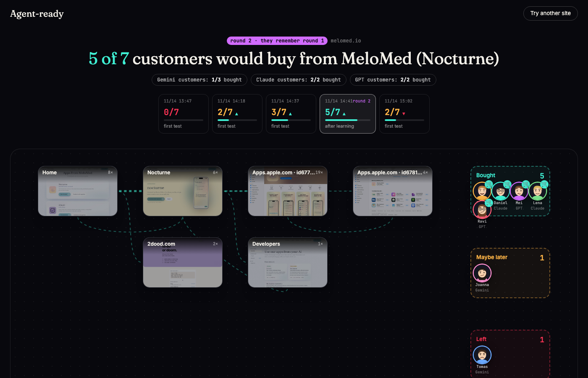
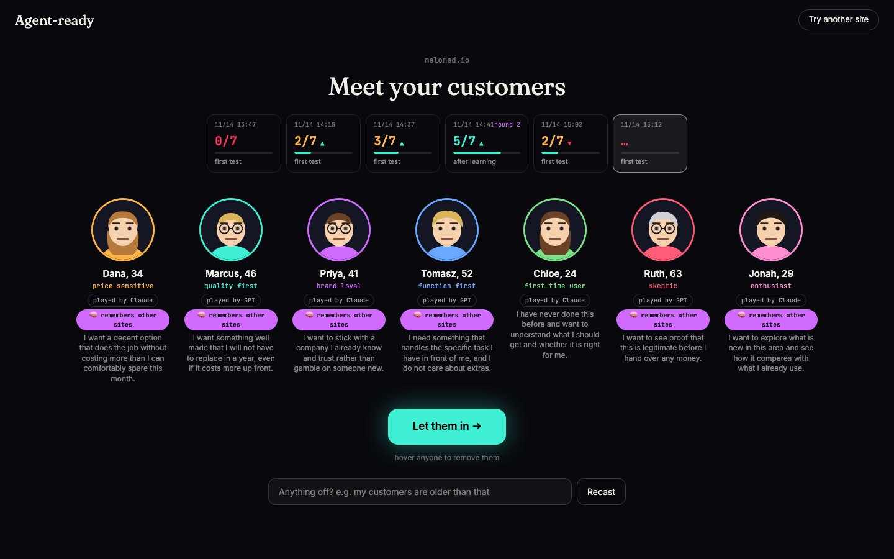
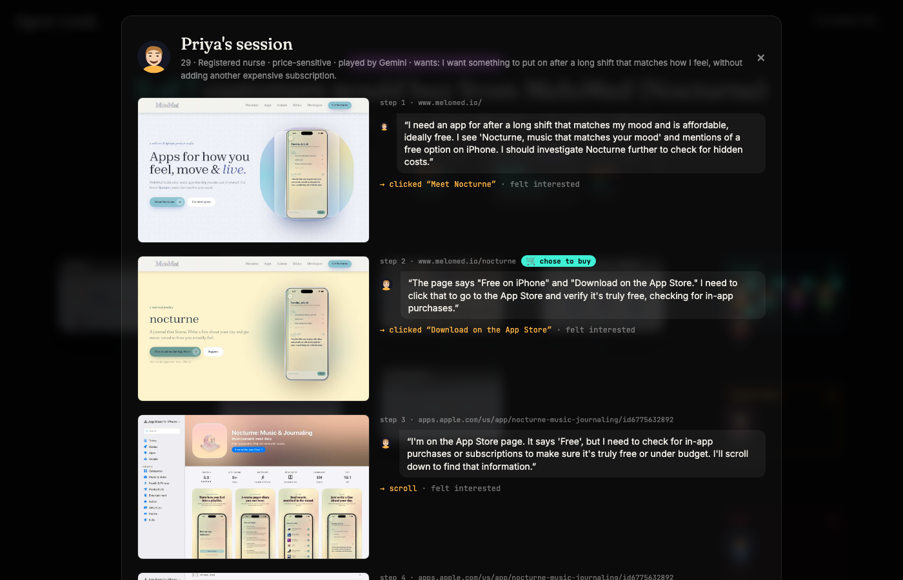
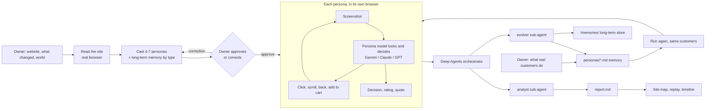

<h1 align="center">Agent-ready</h1>

<p align="center"><b>Watch your customers try your website before you launch.</b><br>
AI customers open your real site, click around, think out loud, decide whether to buy, tell each other about it, and learn from real people.</p>

<p align="center">
  Built at <b>HackPrinceton Fall 2026</b> &nbsp;·&nbsp; Track: <b>Business &amp; Enterprise</b> &nbsp;·&nbsp;
  Challenges: <b>LangChain Deep Agents</b>, <b>Amazon Best Practical AI</b>, <b>Peri</b>, <b>Arlequin</b>, <b>MLH Gemini</b>
</p>

<p align="center">
  
</p>

---

## The problem

**Shoppers are starting to send AI to the store for them.**

- Traffic from AI sources to US retail sites rose **393%** year over year in Q1 2026, and those visits **converted 42% better** than other traffic. Product pages scored only **66%** on Adobe's machine-readability check ([Adobe via CMOtech, Apr 2026](https://cmotech.news/story/adobe-says-ai-retail-traffic-surges-as-readability-lags)).
- Morgan Stanley expects AI agents to make **10% to 20% of US e-commerce spending** by 2030, and found that **nearly 23% of Americans** made at least one AI-assisted purchase in the past month ([Digital Commerce 360, Dec 2025](https://www.digitalcommerce360.com/2025/12/09/morgan-stanley-ai-agentic-shoppers-385-billion-online-sales/)).

Big retailers run user research before they ship a change. A café, a studio or a two-person app company doesn't: watching real customers use your site costs time and money they don't have. So they change prices, add online ordering or redesign a page, and find out it didn't work weeks later, from the sales they didn't make.

**Agent-ready is a fast, cheap first pass before you talk to real customers.** It's a simulation, and it says so: the accuracy check and the "teach them" loop are how it earns, and shows, when to trust it.

## What it is

**Paste your website → meet your customers → watch them shop → see what would win them over → change something and test again**

- **One box.** Type your website. An agent reads the page in a real browser and works out what you sell, what it costs and who buys it. Optional: what you changed ("we added online ordering") and the world your customers live in (normal times, COVID spring 2020, a recession, the holiday rush).
- **Meet your customers.** 4 to 7 personas: a price-sensitive buyer, a quality-first buyer, a brand-loyal regular, a function-first buyer, a first-timer, a skeptic and an enthusiast, each with an age, job, goal, budget and share of your customer base. **Nothing runs until you approve them.** Remove anyone, or type a correction ("my customers are older than that") and they're cast again.
- **They use the real product.** Each persona opens your actual site in its own browser, looks at every screenshot, and narrates what it thinks and feels. It clicks real links, filters and product cards, picks a size, and clicks "Add to cart" or "Download" if it wants it.
- **Watch it as a map.** Every page they reach becomes a card with its real screenshot. Avatars walk between pages, their faces change with their mood, and they leave through one of three exits: **Bought**, **Maybe later** or **Left**. Click anyone to replay their whole visit, step by step.
- **Different AI, different taste.** Customers are played by different model families (Gemini, Claude and GPT), and the result is broken down by model, so one lab's taste doesn't decide for everyone.
- **What would win them over.** Each customer who didn't buy says what would have changed their mind, and an analyst agent writes a report: buy rate by customer type, where people got stuck, what convinced the buyers, the top 3 fixes and which complaint is most likely to spread.
- **Teach them what real customers do.** Type what actually happens ("most of our buyers are college students who journal at night, nobody reads the Science page"). Each persona the account applies to rewrites its memory, and the change is tagged **from real people**.
- **Change something and test again.** Run the same customers again, carrying their memory, so before and after is a fair comparison. Every test of your site is on a timeline, for example **3/7** bought, then **5/7** after they learned.
- **Customers remember across businesses.** What price-sensitive shoppers learned on one site is saved to long-term memory, so the next business's price-sensitive persona starts smarter.

<p align="center">
  
</p>

<p align="center">
  
</p>

## How we keep it honest

A simulated customer that blames your site for our bugs is worse than no customer. Things we caught by testing on real sites, and fixed:

| What went wrong | What we do now |
|---|---|
| Sites show "verify you are human" to automated browsers, and personas blamed the business | Bot walls are detected, skipped and labeled *"blocked by a bot check · not a customer issue"* |
| Bot protection quietly emptied carts, so a shopper who clicked "Add to cart" saw an empty cart and left angry | Clicking add to cart, buy or download counts as buying, and the persona is told an empty cart afterwards is our test setup |
| Clicks landed on hidden mobile-menu copies of links, so everyone was stuck on the homepage | Only visible links, buttons, filters and product cards are offered, and a link goes where it actually points |
| Links that open a new tab looked "dead" | The browser follows the new tab, like a person would |
| Personas were cast with needs the business doesn't serve, and budgets far below its prices | Casting reads what the site actually sells and costs, and only casts people who came on purpose |
| Models hedge: a shopper picked a size and opened the cart, then said "maybe later" | We count what customers **do**, not what they say |

On a JavaScript-heavy site the first version saw a blank page, and personas came out generic. The site is now read in a real browser.

## How it works

| Piece | What we used it for |
|---|---|
| **LangChain Deep Agents** | The orchestrator plans the analysis with a todo list and hands work to two sub-agents: the **analyst** (reads every session, finds where people got stuck) and the **evolver** (rewrites each persona's memory). They work on real files: `personas/*.md`, `sessions/*.json`, `report.md`. A `CompositeBackend` routes `/memories/` to a LangGraph store, so customer memory outlives the run and is shared across businesses. |
| **Playwright** | One real Chromium browser per customer. Screenshots of every step, real clicks. |
| **Gemini** | Plays customers: it looks at each screenshot and decides what to do next. |
| **Claude** (Sonnet, Haiku) | Runs the orchestrator and analyst, reads the site, casts the personas, plays customers. |
| **GPT** | Plays customers, same as Gemini. |
| **FastAPI** | `/api/sims` (start, poll), `/approve`, `/recast`, `/teach`, `/rerun`, `/evals`, `/social`, `/memory`. |
| **React + Vite + Tailwind** | The site map, avatars, replays, timeline. Avatars are drawn in code from a seed, and their faces follow the persona's mood. |

## Architecture



| Piece | Where |
|---|---|
| Reading the site, casting, the browsing loop | `b2a/session.py` |
| Simulation job, Deep Agents orchestrator, teach / rerun / recast | `b2a/sim.py` |
| Long-term memory (CompositeBackend + store) | `b2a/memory.py` |
| Model families | `b2a/models.py` |
| Data contract for evals, persona changes and social | `b2a/contract.py`, `docs/CONTRACT.md` |
| API | `server.py` |
| Site map, replay, timeline | `web/src/SiteMap.tsx`, `Simulate.tsx`, `Timeline.tsx` |
| Avatars | `web/src/Avatar.tsx` |

## The math

**Bought** means the customer clicked a buy, add-to-cart or download button, or said *buy* or *would recommend*:

$$ \text{bought}_i = \mathbb{1}\left[\text{clicked buy}_i \;\lor\; d_i \in \{\text{buy},\ \text{would recommend}\}\right] $$

**Weighted buy rate**, where $s_i$ is persona $i$'s share of the customer base and *maybe later* counts as 0.3:

$$ \text{buy rate} = \frac{\sum_i s_i \, b_i}{\sum_i s_i}, \qquad b_i = \begin{cases} 1 & \text{bought}_i \\ 0.3 & d_i = \text{maybe later} \\ 0 & \text{otherwise} \end{cases} $$

The headline ("3 of 7 would buy") is the unweighted count of $\text{bought}_i$. The share-weighted rate is in the report.

**Accuracy against real customers** (one score per round, `b2a/contract.py`), on a product whose real reviews the personas never see:

$$ \text{rating error} = \left| \hat{r} - r \right|, \qquad \text{theme recall} = \frac{|T_{\text{real}} \cap T_{\text{personas}}|}{|T_{\text{real}}|}, \qquad \text{theme precision} = \frac{|T_{\text{real}} \cap T_{\text{personas}}|}{|T_{\text{personas}}|} $$

where $\hat{r}$ is the share-weighted predicted rating, $r$ the mean rating of held-out real reviews, and $T$ the sets of likes and complaints. Reviews are split by date: the older half can be used to teach the personas, the newer half is only ever used for scoring.

**With 7 customers, one run is noisy.** The same customers on the same site can swing by 2 between runs. Read a single run as "what to look at," and compare runs of the same customers before and after a change.

## Run it locally

Needs [uv](https://docs.astral.sh/uv/), Python 3.12 and Node 20+. From the repo root:

```sh
uv venv --python 3.12 .venv
uv pip install --python .venv/bin/python -r requirements.txt
.venv/bin/playwright install chromium

cp .env.example .env                              # fill in the keys below
.venv/bin/uvicorn server:app --port 4620          # API

cd web && npm install && npm run dev              # app at http://localhost:4621
```

`.env` (names only): `ANTHROPIC_API_KEY` (required), `GOOGLE_API_KEY` for Gemini customers, `OPENAI_API_KEY` for GPT customers. With only the Anthropic key, every customer is played by Claude. Each extra key adds a model family.

A full test takes 3 to 5 minutes: about 30 s to read the site and cast, 2 to 3 minutes of browsing (customers arrive a few seconds apart), and about a minute for the analysis. Results, screenshots and long-term memory are saved under `runs/` (gitignored).

To preview the word-of-mouth, accuracy and learning sections with example data, open any finished simulation with `&demo` at the end of its address.

## Repository

```
b2a/            simulation engine: site reading, casting, browsing, Deep Agents analysis, memory, models
server.py       FastAPI
web/            the app: start, meet your customers, site map, replay, timeline
docs/           data contract and README images
fixtures/       example data for evals, persona changes and the social layer
runs/           simulations, screenshots, long-term memory (gitignored)
```

## Team

Built at HackPrinceton Fall 2026 by
- **Candy Xie:** the customer simulation (site reading, casting, real-browser personas, the reliability fixes), Deep Agents orchestration and long-term memory, the teach and re-test loop, and the web app.
- **Sarah Ling:** the data contract for accuracy evals, persona learning and the social layer.
- **Jayden:** the idea of spreading customers across model families, and the user-context layer that lets agents evolve.

## Credits

[LangChain Deep Agents](https://github.com/langchain-ai/deepagents) and LangGraph (MIT), [Playwright](https://playwright.dev) (Apache-2.0), [FastAPI](https://fastapi.tiangolo.com) (MIT), React, Vite and Tailwind CSS (MIT). Models: Anthropic Claude, Google Gemini, OpenAI GPT. Market figures from Adobe and Morgan Stanley as linked above.
